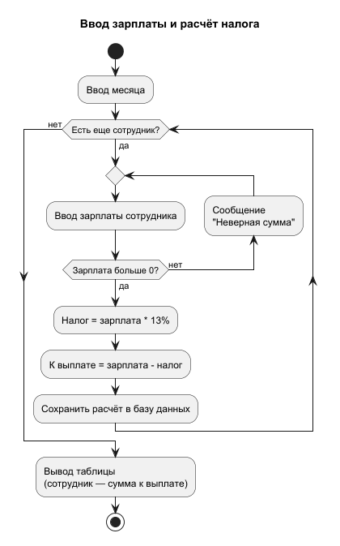
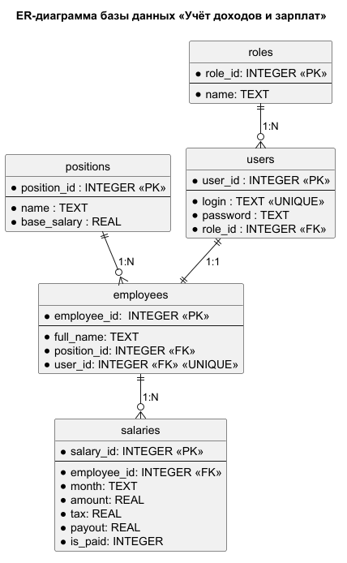

# SalaryAccounting - система для учета доходов и зарплат

**SalaryAccounting** — Это система для учёта зарплаты сотрудников небольшой организации. Система автоматически вычисляет налог и сумму
к выплате, также хранит историю начислений и помогает бухгалтеру избегать ошибок ручного подсчета.


## Цели системы

- автоматически считать **налог** и **сумму к выплате** 
- хранить историю **начислений** и **зарплат** в одном месте
- формировать отчёт за месяц
- давать сотруднику возможность посмотреть свою зарплату


## Пользователи системы

| **Пользователь** | **Описание**                                                                                                                      | 
|------------------|-----------------------------------------------------------------------------------------------------------------------------------|
| *Бухгалтер*      | Главный пользователь(можно сказать администратор). Добавляет сотрудников, вносит зарплату за месяц, отмечает выплаты и смотрит отчёты|
| *Сотрудник*      | Может смотреть свою зарплату, налог и историю своих зарплат|


## Основные функции

### Функции бухгалтера

1. Вход в систему с помощью логина и пароля
2. Добавление, изменение и удаление сотрудников
3. Ввод зарплаты сотрудников за месяц
4. Отметка о выданной зарплате
5. Просмотр отчёта за месяц

### Функции сотрудника

1. Вход в систему с помощью логина и пароля
2. Просмотр зарплаты за месяц
3. Просмотр истории выплат

## Расчёт зарплаты

Бухгалтер вводит сумму зарплаты, а система считает налог и сумму к выплате:

- **Налог** = Зарплата * 13%
- **К выплате** = Зарплата − Налог
#### Пример работы
| **Зарплата** | **Налог** | **Итог** |
|--------------|-----------|----------|
| 100.000p     | 13.000p   | 87.000   |


## Архитектура

### Система построена по трёхуровневой архитектуре:

```text
     Слой интерфейса            #Меню: пользователь выбирает пункт, вводит данные и видит результат
            |
            ▼
    Слой бизнес-логики          #проверяет введённые данные и считает налог и сумму к выплате
            |
            ▼
        Слой данных             #сохраняет данные (по типу сотрудники, пользователи, зарплаты) в базу данных и достаёт их при необходимости
```


## Структура проекта

```text
SalaryAccounting/
├── docs/
│   └── diagrams/          # Диаграммы PlantUML
├── src/
│   └── salary_accounting/ # Исходный код
│       ├── database/      # Слой данных
│       │   ├── __init__.py
│       │   ├── schema.sql # Создание таблиц и тестовые данные
│       │   ├── init_db.py # Скрипт создания базы данных
│       │   └── salary.db  # Файл базы данных SQLite
│       ├── __init__.py
│       └── main.py        # Точка входа
├── tests/                 # Тесты
├── .gitignore
└── README.md
```


## Используемые технологии

| **Технология** | **Версия**           | **Назначение**         |
|----------------|----------------------|------------------------|
| **Python**     | 3.14.0               | Язык программирования  |
| **PyCharm**    | 2026.1               | Среда разработки       |
| **Git**        | 2.56.0               | Система контроля версий |
| **GitHub**     | —                    | Хранение репозитория и совместная работа |
| **Markdown**   | —                    | Оформление документации |
| **PlantUML**   | плагин plantuml4idea | Построение диаграмм    |
| **SQLite**     | встроена в Python (`sqlite3`) | База данных   |
| **DB Browser for SQLite** | 3.13.1    | Просмотр базы данных   |


## Диаграммы

Диаграммы построены с помощью **PlantUML** и хранятся в папке `docs/diagrams/`:

- `usecase.puml` — диаграмма вариантов использования (Use Case)
- `activity_salary.puml` — диаграмма активности «Ввод зарплаты и расчёт налога»
- `er.puml` — ER-диаграмма базы данных


### Диаграмма ввод зарплаты и расчёт налога




## База данных

В проекте используется база данных **SQLite**. Вся база хранится в одном файле `salary.db`,
отдельный сервер не нужен.

### ER-диаграмма



### Таблицы

| Таблица | Назначение | Ключи |
|---------|------------|-------|
| `roles` | Роли пользователей (Бухгалтер, Сотрудник) | PK `role_id` |
| `users` | Логины и пароли для входа в систему | PK `user_id`, FK `role_id` |
| `positions` | Должности и их оклады | PK `position_id` |
| `employees` | Сотрудники | PK `employee_id`, FK `position_id`, FK `user_id` |
| `salaries` | Начисления зарплаты по месяцам | PK `salary_id`, FK `employee_id` |

### Связи

- `roles` → `users` — **1:N** (у одной роли много пользователей)
- `positions` → `employees` — **1:N** (одна должность у нескольких сотрудников)
- `users` → `employees` — **1:1** (у каждого сотрудника свой логин)
- `employees` → `salaries` — **1:N** (у сотрудника начисления за много месяцев)

Сумма зарплаты хранится в `salaries` отдельно от оклада в `positions`, чтобы при изменении
оклада не менялась история прошлых начислений.

### Создание базы данных

Таблицы и тестовые данные описаны в файле `src/salary_accounting/database/schema.sql`.
Чтобы создать (или пересоздать) базу:

```bash
python src/salary_accounting/database/init_db.py
```

После запуска появится файл `src/salary_accounting/database/salary.db`.
Посмотреть таблицы можно в программе [DB Browser for SQLite](https://sqlitebrowser.org/).


## Требования

### Для запуска проекта необходимо установить:

- **Python 3.10** или новее — [Скачать](https://www.python.org/downloads/)
- **Git** — для клонирования репозитория — [Скачать](https://git-scm.com/downloads)

Сторонние библиотеки не требуются


## Работа с Git

Проект использует модель ветвления **feature branch workflow**:

- ветка `main` всегда содержит *стабильную* версию проекта;
- каждое изменение делается в **отдельной ветке**;
- готовая ветка вливается в `main` через **Pull Request** на GitHub.

### Первоначальная настройка Git делается один раз

```bash
git config --global user.name "Имя Фамилия"
git config --global user.email "почта@example.com"
git config --global init.defaultBranch main
```

### Создание репозитория и первая загрузка на GitHub

```bash
git init                                           # создать локальный репозиторий
git add .                                          # добавить все файлы в индекс
git commit -m "Первый коммит: структура проекта"   # зафиксировать изменения
git remote add origin ссылка на репозиторий        # связать с GitHub
git push -u origin main                            # отправить ветку main на GitHub
```

### Типичный цикл работы с веткой

```bash
git checkout -b readme                     # создать ветку и перейти в неё
# ... внесение изменений в файлы ...
git status                                 # посмотреть, что изменилось
git add .                                  # добавить изменения в индекс
git commit -m "Описание"                   # создать коммит
git push -u origin название                # отправить ветку на GitHub
```

## Запуск

### 1. Клонирование репозитория

```bash
git clone https://github.com/ILisov-ml/SalaryAccounting.git
cd SalaryAccounting
```

### 2. Запуск программы

```bash
python src/salary_accounting/main.py
```

### Запуск в PyCharm

1. Открыть папку проекта: **File -> Open** → `SalaryAccounting`
2. Открыть файл `src/salary_accounting/main.py`
3. Нажать правой кнопкой мыши по файлу -> **Run main** 